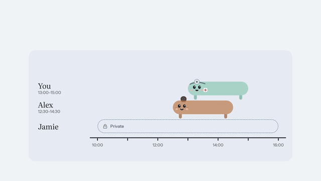
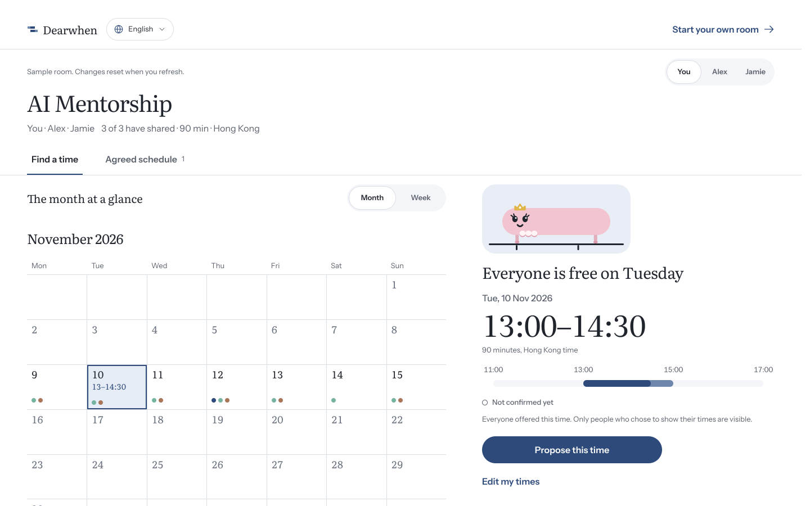
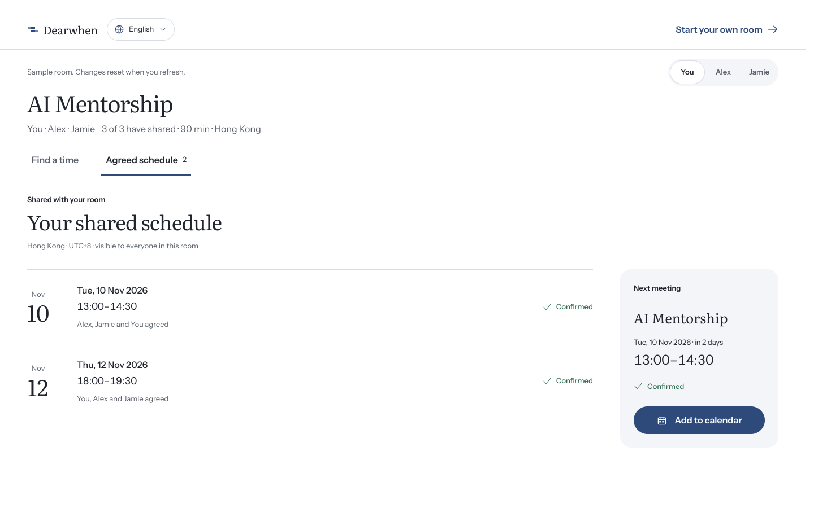

<strong>DEARWHEN</strong>

<h1 align="center">Find a time together.</h1>

A private room where each person paints the times they could meet, the room finds the stretch everyone shares, and a time becomes the meeting only when each person agrees.

<a href="https://dwhen.pages.dev"><b>Open Dearwhen →</b></a> Try the sample room without an account.

Real screens of Dearwhen's public sample room (three sample people), captured on 14 November 2026 by pressing the product's own controls. The seatmates are drawn by the product's own character code. <a href="assets/dearwhen-promo-20261114.mp4">Watch the full film</a> · <a href="assets/dearwhen-promo-20261114-poster.png">Still frame</a> · <a href="assets/dearwhen-promo-20261114-manifest.json">Capture details</a>

## Paint when you could meet

Everyone in a room paints the half-hours that work for them. The room lays each person's time on the same day and names the stretch you all share: everyone is free on Tuesday, 13:00 to 14:30.

## It becomes the meeting when everyone agrees

One person proposes the time. It stays a proposal until each person agrees, and the room shows who has. Then it is on the shared schedule, confirmed.

The public sample room, with three sample people and sample times.

## Development status

Dearwhen is live at [dwhen.pages.dev](https://dwhen.pages.dev). The source code is private.

---

[More projects by Hyunjun Kim](https://github.com/EricEremos) · [Get in touch](https://www.linkedin.com/in/ericmos/)
